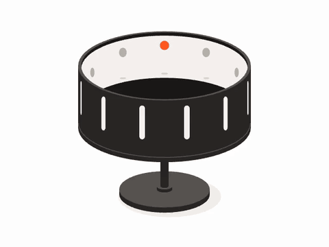
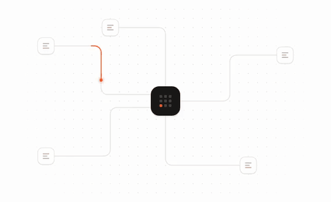
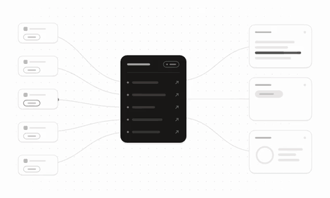

<p align="center">
  <picture>
    <source media="(prefers-color-scheme: dark)" srcset="docs/assets/zoetrope-dark.gif">
    
  </picture>
</p>

<h1 align="center">Zoe</h1>

<p align="center">
  <strong>Polished Lottie animations for your website, designed and built by Claude.</strong>
</p>

<p align="center">
  <a href="#examples">Examples</a> ·
  <a href="#how-the-skill-works">How it works</a> ·
  <a href="#using-the-skill">Get started</a>
</p>

<br>

Zoe is a [Claude Code](https://claude.com/claude-code) skill for the small animated illustrations that explain a product idea in a few seconds, like data flowing into a hub or friends joining a trip. It ships each one as a drop-in React component.

You describe a concept. Claude explores several visual ideas, picks the strongest one, computes every motion in code, checks the result for collisions, jerky motion and loop seams, then renders frames and critiques them before handing you a component. The zoetrope above was made this way.

This repo contains the skill itself and a Next.js showcase with three animations built with it.

## Why "Zoe"?

*Zoe* is Greek for "life". It's also the root of the *zoetrope*, a spinning drum with slits around its edge. Look through the slits as it turns and a strip of drawings inside comes to life as motion. It was one of the first animation devices, back in the 1830s.

That's what this skill does: it takes an idea that would otherwise be a paragraph of copy and brings it to life in a few seconds of motion. Zoe is also a name, which suits the skill: you hand it a brief the way you'd brief a motion designer on your team.

## Examples

<table>
  <tr>
    <td width="50%">
      <picture>
        <source media="(prefers-color-scheme: dark)" srcset="docs/assets/packet-routing-dark.gif">
        
      </picture>
    </td>
    <td>
      <strong>PacketRouting</strong><br>
      Packets travel routed lines from five nodes into one hub, which reacts to each arrival.
    </td>
  </tr>
  <tr>
    <td width="50%">
      <picture>
        <source media="(prefers-color-scheme: dark)" srcset="docs/assets/single-source-dark.gif">
        
      </picture>
    </td>
    <td>
      <strong>SingleSource</strong><br>
      Data from five sources fills the rows of one central hub, which then feeds three different tools.
    </td>
  </tr>
  <tr>
    <td width="50%">
      <picture>
        <source media="(prefers-color-scheme: dark)" srcset="docs/assets/trip-invite-dark.gif">
        
      </picture>
    </td>
    <td>
      <strong>TripInvite</strong><br>
      An invite link is shared and four friends fly into a trip's avatar stack.
    </td>
  </tr>
  <tr>
    <td width="50%">
      <picture>
        <source media="(prefers-color-scheme: dark)" srcset="docs/assets/zoetrope-dark.gif">
        
      </picture>
    </td>
    <td>
      <strong>Zoetrope</strong><br>
      The device this skill is named after: the drum spins and its strip of still drawings comes to life as a bouncing ball. It's the animation at the top of this page.
    </td>
  </tr>
</table>

Each one has light and dark themes, plays only while on screen, and shows a still frame to visitors who prefer reduced motion. To see the first three live in their sections, run the showcase:

```bash
npm install
npm run dev   # http://localhost:3000
```

## How the skill works

The skill doesn't hand-write Lottie JSON. Claude writes a short build script using a bundled toolkit, and the toolkit does the maths:

1. **Ideation.** It produces at least four different visual ideas, scores them on clarity, specificity, legibility at small sizes and loopability, and picks one.
2. **Design spec.** It sets a grid, a palette for light and dark (taken from your project's tokens when available), element sizes and layout maths.
3. **Build.** Geometry and motion are computed: constant-speed travel along curves, springs, staggered timing and seamless loops. The toolkit exports this as compact Lottie that plays back exactly as computed.
4. **Verify.** An analyser checks for overlaps, tight gaps, abrupt starts and stops, elements popping in and loop seams. A renderer plays the animation in headless Chrome and saves contact sheets, motion-trail images and frame strips, which Claude looks at and critiques for at least two rounds.
5. **Package.** It produces a component folder with the light and dark animation files, a typed wrapper and the build script, so the animation can be edited and regenerated later.

## Using the skill

**Requirements:** Claude Code, Node.js 20.11 or later, and about 150MB for the headless Chrome used by the renderer (installed on first use).

1. Install Zoe as a plugin. In Claude Code, run:

   ```
   /plugin marketplace add ValerianCoelho/zoe
   /plugin install zoe@zoe
   ```

   This installs the skill and the `zoe-designer` subagent for all your projects. Run `/plugin marketplace update zoe` later to get new versions.

   <details>
   <summary>Or copy the files by hand</summary>

   ```bash
   # for one project
   cp -R .claude/skills/zoe   <your-project>/.claude/skills/
   cp    .claude/agents/zoe-designer.md <your-project>/.claude/agents/

   # or for all your projects
   cp -R .claude/skills/zoe   ~/.claude/skills/
   cp    .claude/agents/zoe-designer.md ~/.claude/agents/
   ```

   Copied this way, the skill runs as `/zoe` and the subagent is `zoe-designer`.
   </details>

2. Start a new Claude Code session and ask for an animation:

   ```
   /zoe:zoe data packets routed from many regions into one core, for the hero's right column
   ```

   Or just describe the animation you want and Claude will pick up the skill. From an orchestrating agent, delegate to the `zoe:zoe-designer` subagent (it runs on Opus with the skill preloaded) with a brief: the concept, where it will be used, brand constraints and the output folder.

3. Install `lottie-web` in your project if the skill reports it's missing, then import the component:

   ```tsx
   import TripInvite from '@/components/motion/examples/TripInvite';

   <TripInvite />
   ```

[docs/motion-components.md](docs/motion-components.md) covers the component props, theming, reduced motion and how to regenerate an animation. For non-React sites, the skill can also produce a framework-agnostic `<lottie-motion>` web component.

## Repository layout

```
.claude-plugin/                 plugin and marketplace manifests
.claude/skills/zoe/             the skill
  SKILL.md                      the playbook Claude follows
  references/                   art direction, motion principles, concept patterns, toolkit API, QA checklist
  scripts/                      toolkit: builder and analyser, renderer, validator, component scaffolder
  templates/                    React player, web component, component wrapper
  examples/                     reference build script
.claude/agents/                 zoe-designer subagent
components/motion/              shared player and the example components
app/page.tsx                    showcase page
docs/                           component documentation
```

## Third-party notices

The animal avatars in **TripInvite** are from Microsoft's [Fluent Emoji](https://github.com/microsoft/fluentui-emoji), used under the MIT License. See [components/motion/examples/TripInvite/THIRD_PARTY_NOTICES.md](components/motion/examples/TripInvite/THIRD_PARTY_NOTICES.md).

## License

No license has been chosen yet, so all rights are reserved for now.
