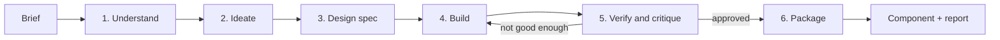

# How Zoe works

This document explains how the Zoe skill turns a one-line brief ("make a zoetrope") into a finished, theme-aware animation component.

- **Part 1** is the big picture: the workflow as a chain of steps, each with a clear input and output.
- **Part 2** goes module by module: what each file does, how it works at the code level, and which tools it uses.

The zoetrope at the top of the README is used as a running example throughout.

---

# Part 1: The workflow at a high level

## The one idea to remember

Zoe splits the work between two kinds of worker:

- **Claude does the judgment.** It decides what the animation should show, how it should look, and whether the result is good enough. Judgment is written down as text (a concept document) and as code (a build script).
- **Scripts do the maths and the checking.** They compute every position and timing exactly, export the animation file, and measure the result. They never make taste decisions; they report facts.

Claude never writes the animation file by hand. It writes a small program that *generates* the file, runs it, looks at the output, and edits the program until it's right. That's why the results are precise and reproducible: the animation is the output of code, not of hand-placed keyframes.

## What the output is

The end product is a **Lottie** animation: a JSON file describing vector shapes and how their properties (position, scale, colour…) change over time. Lottie came from After Effects, and the `lottie-web` library plays these files in the browser by drawing them as SVG. Unlike a video or GIF, a Lottie file is tiny (around 100KB here), stays sharp at any size, and can be recoloured per theme.

Zoe wraps two of these files (light and dark) in a React component that handles playback, theming and accessibility.

## The pipeline



Each step, as input → output:

| # | Step | Input | What happens | Output |
|---|---|---|---|---|
| 1 | **Understand** | The brief, the target codebase | Claude restates the brief as one sentence a visitor should *feel*, and reads the project: framework, colours, dark-mode strategy, where the animation will sit. | A concept sentence ("Still frames, set spinning, come to life") and a list of facts about the destination |
| 2 | **Ideate** | The concept sentence | Claude writes at least four genuinely different visual ideas, scores each on six criteria (clarity, specificity, legibility when small, loopability, restraint, room for craft) and picks a winner. | `concept.md` with the scored ideas, the winner, and a **beat sheet**: what moves when, frame by frame |
| 3 | **Design spec** | The winning idea | Claude fixes the grid, sizes, palette for both themes, which element sits on top of which, and the motion rules (easing, speed, loop strategy). | The spec, appended to `concept.md` |
| 4 | **Build** | The spec | Claude writes `build.mjs`, a script that uses the toolkit to compute the whole scene. Running it exports the animation and prints an automatic analysis. | `light.json`, `dark.json`, and an analysis report (errors, warnings, a timeline of who moves when) |
| 5 | **Verify and critique** | The two JSON files | Scripts lint the files and render real frames in a headless browser. Claude looks at the images, goes through a QA checklist like an art director, lists improvements and edits the build script. This loops at least twice. | Review images (contact sheets, motion trails, frame strips) and motion metrics; an improved `build.mjs` |
| 6 | **Package** | The approved JSON and build script | A script creates the component folder, reusing the project's shared player. | `components/motion/<Name>/` with `index.tsx`, `light.json`, `dark.json`, `source/build.mjs` |

The output of the whole run is that folder plus a short report: what was built, why that idea won, what was checked, and what assumptions were made.

## Who does what

| Concern | Done by | Why |
|---|---|---|
| What to show, how it should feel | Claude, guided by the reference docs | Needs taste and context |
| Geometry, timing, curves, exact loops | `lottie-kit.mjs` | Needs precision; humans and models are bad at hand-placing hundreds of numbers |
| "Is anything colliding, popping or jerky?" | The kit's analyser | Mechanical checks, run on every build |
| "Does it play correctly in a real player?" | `render.mjs` and `validate.mjs` | Truth comes from the actual renderer, not from our own model of it |
| "Does it look good?" | Claude, reading the rendered images | Numbers don't catch ugliness |
| Shipping it into the app | `scaffold.mjs` and the player template | Repetitive and must be consistent across animations |

## How you can trigger it

- Type `/zoe <brief>` in Claude Code, or
- have another agent delegate to the **zoe-designer** subagent (`.claude/agents/zoe-designer.md`), which runs on Opus at maximum effort with the skill preloaded and returns only the report.

---

# Part 2: The modules in depth

## Map of the files

```
.claude/
  agents/zoe-designer.md          subagent definition: model, effort, which skill to preload
  skills/zoe/
    SKILL.md                      the playbook: the six phases and their rules
    references/                   knowledge Claude reads before working
      art-direction.md              what makes it look made by a studio
      motion-principles.md          easing, timing, choreography, loops
      concept-patterns.md           14 proven visual metaphors and their traps
      kit-api.md                    reference for the toolkit
      qa-checklist.md               the art-director pass
    examples/packet-routing/      the reference build script (the quality bar)
    scripts/
      lottie-kit.mjs                the toolkit: scene model, maths, export, analyser
      render.mjs                    renders frames in headless Chrome; pixel-level motion checks
      validate.mjs                  structural lint of any Lottie file
      scaffold.mjs                  packages the result as a component
      selftest.mjs                  exercises every toolkit feature end to end
      package.json                  the scripts' only dependencies: lottie-web, puppeteer
    templates/
      react/LottieMotion.tsx        shared React player
      react/Component.tsx.tmpl      per-animation wrapper
      web/lottie-motion.js          framework-agnostic <lottie-motion> web component
components/motion/                where the finished components live
```

## 1. The playbook: `SKILL.md`

**What it is:** a Markdown file with front matter. Claude Code reads it when the skill is invoked and follows it as instructions. It's the "process" layer; it contains no executable code.

**What it defines:**

- The **role**: a motion designer at a small studio whose work goes on a client's marketing site.
- The **ground rules** that keep output consistent: work autonomously, read the references first, compute everything (never nudge a number until it looks right), one source of truth per moving thing, never ship with analyser warnings, and *always look at the rendered frames*.
- The **six phases** from Part 1, each with concrete commands to run and criteria to meet.
- The **final report** format.

**Why it matters:** this file is what turns a general-purpose model into a disciplined pipeline. For example, the rule "at least four genuinely different metaphors, scored" is why the zoetrope was compared against a top-down diagram, a strip curling into a drum, a through-the-slit close-up and a phenakistoscope before one was chosen.

## 2. The knowledge: `references/`

Five Markdown files Claude reads before building. They encode taste as rules, so quality doesn't depend on luck.

| File | What it gives Claude | Example rule |
|---|---|---|
| `art-direction.md` | A table of "tells" that make work look generated, and what to do instead; palette and composition rules | "One accent colour, and it marks only what the visitor should track" |
| `motion-principles.md` | Which easing curve to use for which intent, timing ranges, choreography, loop construction | "Small moves take 18–30 frames; long travel is based on speed, not duration" |
| `concept-patterns.md` | 14 proven metaphors (routing, distribution, sync, pipelines…) with craft details and traps | "Hub-and-spoke: don't rotate the whole wheel" |
| `kit-api.md` | The toolkit's API | How `bake`, `cycle` and `pointAt` work |
| `qa-checklist.md` | The checklist for each critique round | "Responses land on the contact frame, ±1" |

## 3. The toolkit: `scripts/lottie-kit.mjs`

This is the heart of the system: a single dependency-free JavaScript module (about 1,400 lines) that build scripts import. It has six parts.

### 3a. The scene model

It mirrors Lottie's own structure, so export is a direct translation:

```
Scene                      canvas size, frame rate, duration, loop flag, markers
 └─ Layer                  a drawable element with its own transform; can have a parent and a matte
     └─ Group              a bundle of shapes with its own transform
         ├─ geometry       rect, ellipse or path
         ├─ modifiers      trim (draw a path partially), round corners
         └─ styles         fill, stroke, gradient
```

Every animatable value (position, scale, rotation, opacity, colour, trim, a path's shape…) is a **`Prop`**. A Prop holds either a static value or a list of keyframes, each with a time, a value and an easing curve.

A build script reads like a description of a drawing:

```js
const ball = live.circle({ name: 'ball', r: 9, fill: P.accent });
ball.position.bake(t1, t5, (f) => [cx, groundY - hopHeight(livePhase(f))]);
```

### 3b. Easing and timing helpers

- **`ease.*`**: named easing curves (`out`, `inOut`, `smooth`, `linear`…), each a cubic Bézier (the same representation CSS and After Effects use). `CubicBezier` evaluates them by solving for time with Newton's method plus bisection.
- **`spring()`**: an analytic damped-spring solution, so a "settle into place" motion is exact physics instead of a hand-drawn wobble.
- **`stagger()`**: delays for a sequence, optionally decaying so the first items go quickly and later ones relax.
- **`rng(seed)`**: a seeded random generator, so "random" variation is identical on every rebuild.

### 3c. `bake()`: turning any function into keyframes

This is the key technique. Instead of hand-placing keyframes, a build script gives the kit a **function of time** (for example "the ball's height at frame *f*"), and `bake` converts it into the fewest keyframes that reproduce it within a tolerance (typically 0.1–0.5px).

How it works (`fitHermite`):

1. Lottie interpolates between two keyframes with a cubic Bézier easing curve. If the curve's time handles are fixed at 1/3 and 2/3, that curve becomes mathematically identical to a **cubic Hermite** segment: one defined by the value *and the slope* at each end.
2. So for a candidate segment, the kit samples the function's value and slope at both ends, computes the matching Bézier handles, and measures the worst error against the real function along the segment.
3. If the error is above tolerance, it splits at the worst point and repeats on both halves.

The result is a curve whose value and velocity are continuous everywhere (no jerks), stored in very few keyframes. This is what makes "everything is computed" practical: a bouncing ball, a slit moving around a drum in perspective, a spring, all become compact keyframes automatically.

### 3d. `cycle()`: seamless loops by construction

For things that repeat (a packet sent every beat), `cycle(prop, starts, duration, fn)` runs the same function for each start time, wraps times around the loop length, and splits any trip that crosses the loop point across the seam. That guarantees frame 0 and the last frame match exactly in both value and speed, so the loop has no visible restart.

The zoetrope used the same idea differently: its drum turns exactly two full revolutions per loop, so every slit and drawing ends exactly where it started.

### 3e. Paths and colour

- **`BezierPath`** stores curves with absolute control points. It builds a lookup table of arc length, so **`pointAt(u)`** returns the point at a given fraction of the *distance* along a path, not of the curve parameter. That's what gives constant on-screen speed along curves.
- Constructors: `Path.smooth` (a curve through points, Catmull-Rom), `Path.rounded` (straight lines with circular fillets at the corners, for circuit-style routes), `Path.connector`, `Path.cable`, `Path.arc`, `Path.circle`, and `Path.svg` / `parseSvg` to import SVG artwork (that's how TripInvite's animal avatars got in).
- `path.kinks()` finds "stick joints": points where a supposedly smooth curve has a corner.
- **Colour**: `mix()` blends in the OKLab colour space, which stays clean where plain RGB blends go muddy; `contrast()` computes WCAG contrast ratios for checking hierarchy.

### 3f. Export: `toJSON()` and `save()`

Translates the scene into Lottie JSON. The details it handles so build scripts don't have to:

- **Paint order.** The kit uses "added later = drawn on top"; Lottie uses the opposite, so lists are reversed.
- **Track mattes** (using one layer as a stencil for another): the stencil must sit directly above its target in the file, so it's moved there automatically.
- **Separated position.** Layer positions are split into separate x and y curves, which Lottie animates more accurately.
- **Precision.** Numbers are rounded (2–3 decimals) to keep the file small.

### 3g. The analyser: `analyze()`

After building, the script calls `s.analyze().print()`. The analyser evaluates the scene with the same maths Lottie uses and reports:

| Check | What it catches |
|---|---|
| `kink` | A sudden change of velocity at a keyframe: an abrupt start or stop, or a direction snap |
| `cut` | A value that jumps instantly while the element is visible |
| `pop` | An element whose visibility jumps more than 45% in one frame instead of easing in |
| `loop-seam` | A value or speed that differs between the first and last frame (a visible hitch when it loops) |
| `overlap` / `clearance` | Shapes that touch, or come closer than a declared gap; sampled every half frame using polygon distance |
| `bounds` | An element leaving the safe area near the canvas edge |
| `jitter` | Rapid back-and-forth direction reversals |

It's **occlusion-aware**: if something is fully hidden under an opaque shape, jumps and pops there aren't reported, because nobody can see them. The build script declares the rules it expects to hold (`noOverlap`, `keepInside`, `occluders`), so the analyser checks *this* animation's promises.

When a warning describes intended behaviour (a ball's velocity really does reverse when it bounces), the script marks it with `.allow('kink')` plus a comment saying why. Nothing is silenced without a reason.

It also prints a **choreography timeline**, one text row per layer showing when it moves, which shows at a glance whether the rhythm has rests or is a wall of constant motion.

## 4. The build script: `build.mjs` (one per animation)

Written fresh by Claude for each animation and kept in the component's `source/` folder so it can be regenerated later. It always follows the same five-section structure (see `examples/packet-routing/build.mjs`):

1. **Tokens**: the colour palette for light and dark themes.
2. **Layout**: every position and size, computed from a grid and geometry rather than eyeballed.
3. **Timing**: durations derived from distances and a beat, not picked by feel.
4. **`build(theme)`**: one function constructs the whole scene from the tokens. Light and dark are the same function with different colours, so their motion is guaranteed identical.
5. **Analysis rules**, then save both themes and print the report.

The zoetrope's script shows the "one source of truth" idea well. A single function, the drum angle `theta(f)`, drives everything:

- the 12 slits' positions and their perspective narrowing,
- the 12 drawings on the inner strip,
- the live ball's phase in its bounce,
- and how faded the drawings are (faster spin, more blur).

Because they all read the same function, nothing can drift out of sync.

## 5. The verification tools

### `render.mjs`: what the real player shows

- **Tools:** **Puppeteer** drives a headless **Chrome**, which loads the real **lottie-web** player, the same library the website uses.
- **How:** for each requested frame, it calls `goToAndStop(frame)`, takes the SVG lottie-web produced, turns it into an image, and draws it onto a canvas. All of this happens inside the browser page.
- **Outputs** (PNG images Claude then looks at):

| Output | What it shows |
|---|---|
| `sheet.png` | A contact sheet of evenly spaced frames: the story over time |
| `onion.png` | Many frames overlaid semi-transparently: motion paths, showing smooth arcs versus zigzags |
| `strip_a-b.png` | Every frame in a range, optionally cropped and enlarged, for checking a moment frame by frame |
| `frame_NNNN.png` | Single frames at 2× for pixel detail |
| `preview.mp4` | Optional video via **ffmpeg** (this is how the README GIFs were made) |

- **Motion metrics** (printed as JSON): it compares every frame with the next, pixel by pixel.
  - **`spikes`**: frames that change far more than their neighbours, meaning a pop or teleport.
  - **`loopSeam`**: whether the last frame flows into the first.
  - **`stillness`**: whether the planned rests actually happen.

This is independent from the kit's own analyser, so it catches anything the kit's model of Lottie gets wrong.

### `validate.mjs`: is the file portable?

A fast structural lint of any Lottie file:
- required fields and a sensible frame rate;
- file size (warns over 150KB, fails over 500KB);
- keyframe times in order, and path morphs with matching point counts;
- track mattes in the right place.

It also flags features that break in lightweight players: expressions, effects, merge paths, text and image layers, and 3D layers.

### `selftest.mjs`: is the toolkit itself working?

Builds a scene that exercises every toolkit feature (springs, staggers, paths, morphs, trims, mattes), analyses it, validates it, renders a small contact sheet, and prints a pass/fail line for each check. Run it after changing the toolkit.

## 6. Packaging: `scaffold.mjs` and the templates

### `scaffold.mjs`

Turns a build's output into a component folder:

1. Copies `light.json` and `dark.json` into `components/motion/<Name>/`.
2. Generates `index.tsx` from `Component.tsx.tmpl`: size, accessible label, poster frame, description.
3. Finds the **shared player** by walking up from the destination folder. It reuses an existing `LottieMotion.tsx` if there is one, and only creates one from the template otherwise. That's why all examples share one player.
4. Copies `build.mjs` into `source/` and rewrites its toolkit import path so it still runs from the new location.
5. Reports whether the project still needs `lottie-web` installed.

It refuses to overwrite a folder containing files it didn't create, unless forced.

### `LottieMotion.tsx`: the shared React player

What every animation component renders. Its behaviour:

| Feature | How it's done |
|---|---|
| Small bundles | `lottie-web`'s light SVG build and the animation JSON are loaded with dynamic `import()`, so each lands in its own chunk, and only the active theme's file is downloaded |
| No layout shift | The wrapper reserves the animation's aspect ratio with CSS before anything loads |
| Plays only when seen | An `IntersectionObserver` plays it when at least 20% is visible and pauses it otherwise (or on hover / once, via the `trigger` prop) |
| Theme switching | Reads `html.dark`, `data-theme`/`data-mode`, or the OS setting, and watches for changes with a `MutationObserver` and media queries (wired through React's `useSyncExternalStore`). On change it swaps light/dark JSON and keeps the current frame |
| Reduced motion | If the visitor prefers reduced motion, it shows the chosen **poster frame** as a still and never plays |
| Intro + loop | If the file has `intro` and `loop` markers (TripInvite does), it plays the intro once, then repeats only the loop |
| Accessibility | `role="img"` with an `aria-label` when a label is given; otherwise `aria-hidden` as decoration |

### `lottie-motion.js`: the web component

The same player as a framework-agnostic `<lottie-motion>` custom element, for Vue, Svelte, Astro or plain HTML. It loads `lottie-web` from the project's bundler, or falls back to a CDN.

## 7. The subagent: `zoe-designer.md`

A short agent definition: run on Opus at maximum effort, preload the Zoe skill, follow its phases exactly, infer anything missing from the codebase, and return only the final report (under 40 lines). Another agent can hand it a brief and get a finished component back without the conversation filling up with build logs and images.

---

## Putting it together: the zoetrope, end to end

| Step | Concretely |
|---|---|
| Brief | "Create a zoetrope, since the repo is named after it" |
| Understand | Next.js + React, warm stone neutrals, orange accent from the other examples, a ~560px slot → 640×480 canvas |
| Ideate | Five ideas scored; "a 3/4 view of the drum that spins up and brings a ball to life" won 27/30 |
| Spec | A perspective model (circles appear as ellipses at ratio 0.4), 12 slits, 12 drawings (two bounces of six frames), and a drum angle function as the single source of truth |
| Build | `build.mjs` computes every slit, drawing and the ball from that angle; the analyser reported 0 errors and 0 warnings |
| Verify | Three critique rounds: redesigned the interior, cut the file from 174KB to 104KB, softened the dark theme, compared a white drum against a dark one, retimed the slow-down |
| Package | `components/motion/examples/Zoetrope/`, sharing the existing player |
